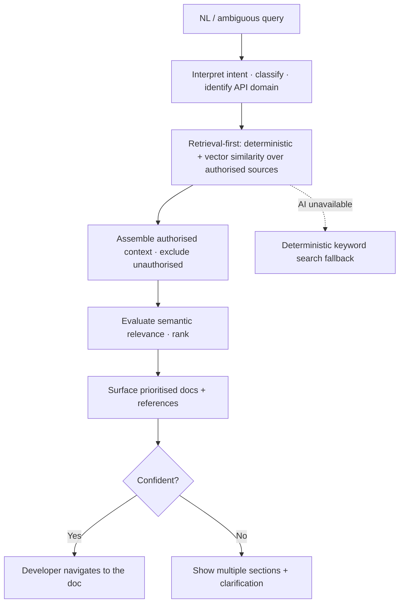
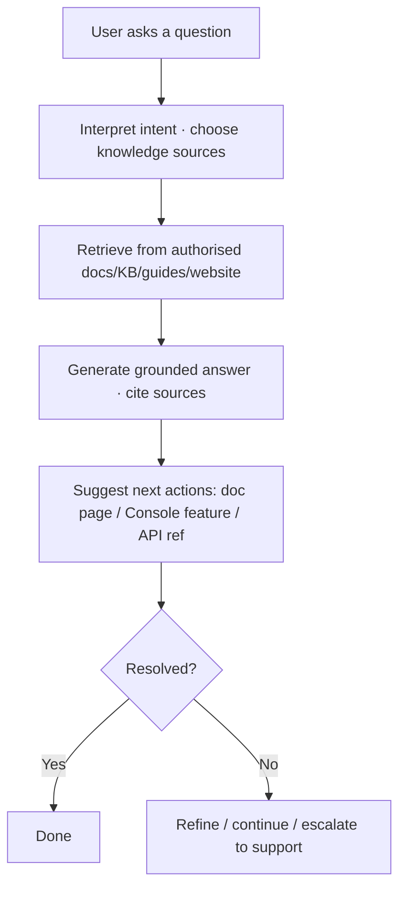

# TXN — Developer Support: Portal Co-pilot

> **Component:** [[developer-support]] · **Journey sources:** [[ux-txn-intelligence-enhanced-documentation-discovery|Documentation Discovery]], [[ux-ai-user-stories-and-requirements|User Stories & Requirements]] · **Vision:** [[vision]]
> **Date:** 2026-06-10
> **Status:** Defined
> **Owner:** _TBC_
> **Sources:** [[09-06-2026-developer-support]] (deliberately-light co-pilot), [[ux-txn-intelligence-enhanced-documentation-discovery]] (semantic discovery), [[ux-ai-user-stories-and-requirements]] (conversational guidance)

---

## 1. What Does This Sub-Component Do?

**Functional purpose:**

The Portal Co-pilot is the **baseline conversational AI** in the Developer Portal (and, for read-only guidance, the corporate website and Console) — *"chat with the documentation."* It does two related jobs:

1. **Semantic documentation discovery** ([[ux-txn-intelligence-enhanced-documentation-discovery]]) — interpret a developer's natural-language or ambiguous query ("customer paid twice", "why did my payment decline") and surface the right docs by **meaning, not keyword**: retrieval-first over a vector index, contextual ranking, with **deterministic navigation always available as a fallback**.
2. **Conversational guidance** ([[ux-ai-user-stories-and-requirements]]) — answer "how does X work / where's the doc / how do I integrate Y" questions, grounded in authorised sources, **referencing** them and **suggesting next actions** (a doc page, a Console feature, an API ref).

It is **deliberately light**: Ian's explicit steer is to invest in the [[docs-mcp-server]] over the portal chatbot, on the belief that developers increasingly arrive via their own agent. The co-pilot is the solid baseline for those who do use the portal directly — not the headline. It can also **surface existing support-ticket answers** so resolved questions aren't re-raised.

**Entities that interact with it:**

- **External developer** (unknown → client) — asks questions; metered by level.
- **Prospective client** (corporate website) — read-only evaluation questions.
- **Co-pilot agent** — interprets intent, retrieves from authorised sources, ranks, answers with references.

---

> [!note] A UI prototype exists, and the position changes, 22 September 2026
> George on the standup ([[2026-09-22-agentic-standup]]): *"I've been busy working away getting like a UI version of the knowledge hub of the co-pilot, just so that you can get a look and feel. Obviously very basic at the moment."* It is a look-and-feel prototype only, the same way the agent Console was prototyped first, and he expects *"something to show"* the week of 29 September. The MCP server behind it is not promised for that date.
>
> **The entry point moves.** Today it takes two steps, *"click one thing and then you click ask AI and then it pops up."* The intent is a **permanently available side panel**, *"more like a typical co-pilot where it's kind of always there. Click it, pops up straight away"*, without being intrusive. Ian: *"sounds good."*

> [!note] Demonstrated and endorsed, 29 September 2026
> Hasan showed a working co-pilot on the cardholder documentation page, reached through a small **Ask AI** icon ([[2026-09-29-agentic-standup]]). Built early: Brett, *"we've been a little bit cheeky just because we're worried about the timeline, and we've started building the co-pilot because we had some spare capacity."* It therefore arrived **before** the MCP server that was prioritised ahead of it on 16 September.
>
> **What it does today.** Answers a question such as *"how do I issue a card"* with required headers, key fields and optional fields; **cites the source and links to that page**; and produces an **example payload**, expandable for copy and paste.
>
> **Planned next:** chat history, export, one-click copy of the payload *"if you just want to paste it anywhere, into Claude, into ChatGPT"*, and navigating the reader to the relevant page from the answer.
>
> **Michael:** *"It looks fantastic so far. **Exactly what we're thinking** in terms of being there, asking the AI, using the guides, using the reference."* **51 documents** are in the CMS for it to work from.
>
> **The wider principle Ian set on the same call:** build for how developers work now. Marqeta's portal offers per-page export into a model, and Michael's specification for Stackworkz lists copy page, copy as LLM text, view as markdown, **open in ChatGPT**, **open in Claude**, ask in **Perplexity**, **connect with Cursor** and **connect with VS Code**. Stackworkz builds the first few; the MCP install follows from Novosapien. Ian: *"the people who build and connect to that platform will be building in a different way than they traditionally have, and therefore we need to make sure that we're fit for purpose."*

> [!note] Progress, and a reason to bring it forward (06-10-2026)
> **In build, updates due Thursday** ([[2026-10-06-agentic-standup]]): **page navigation**, so asking about an endpoint takes the reader to that page; **chat export** to markdown or straight into Claude, ChatGPT or Perplexity; and next, **the agent making sandbox calls on the user's behalf**, showing the payload and request, with a copy button so a developer can take it into Postman. Michael: *"that's pretty much covered off what we expected to do."*
>
> **And a competitive reason to have it at launch rather than after.** Michael: *"especially now **Marqeta has redesigned their website to be very much co-pilot up front**. So that's quite a shift from them. I think at least matching that would be ideal, either at launch or very close afterwards."*
>
> Dorte wants it prioritised: *"when we go to market we need to have a differentiator to keep the interest, because the moment you launch something that doesn't look fairly interesting testing, people don't go any further. **So it's the one time we launch, we need to get it right.**"* **The decision is Ian's.** [[open-questions]] #105.
>
> **Retention position for the sandbox it sits on:** the public sandbox is kept *"for a very short window of time, obviously public data"*, and the **per-user personal sandbox arrives with sign-up as a later phase**, which confirms the phasing for log-based support at #102.

> [!note] Demonstrated working, 8 October 2026
> Hasan ran the demo alone, at Dorte's insistence, and everything promised two days earlier was working ([[2026-10-08-agentic-standup]]).
>
> | Feature | State |
> |---|---|
> | **Navigates the documentation itself** | Asked *"how do I issue a card"*, it answers **and opens the relevant API page**. Dorte checked it was the software rather than Hasan: *"it was the AI that did it"* |
> | **Example payloads** | On request, with a copy button on each example |
> | **Chat history** | Behind a clock icon, previous conversations browsable |
> | **Export** | To clipboard or download, as a **handover document for another AI**: how to use it, a summary, **all the sources**, and the full transcript |
> | **Execute API calls** | Next, showing payload and output |
> | **MCP server** | Still being built, to be integrated after |
>
> **Storage, and it matters beyond the feature.** History is **not stored server-side**: *"it's stored inside the browser cache, and after 30 days it will just automatically clear itself out."* Persistent storage arrives only with sign-in. **Dorte: *"it's brilliant, because this goes to my bloody privacy policies."*** That narrows the legal surface at [[open-questions]] #103: no new data store, no retention schedule, no subject-access route for anonymous visitors.
>
> **Decision: the assistant gets no name.** Dorte: *"I don't think we need to name the assistant at all... this does the trick."* In contrast to Novosapien's own Nova in the Content Workforce.
>
> **Two notes.** The login seen in the demo is on **Novosapien's replica hub in staging**, not the real one, which stays public and unauthenticated at MVP (#91). And the co-pilot is **not yet linked from the admin portal**, reachable only at `/docs`.
>
> **Who to pitch it to.** Dorte, unprompted: *"the last time you demoed, I said to Mike afterwards, I'm glad you liked it, because I could not follow. But Mike needs to like it... **if Mike understands it, he's a happy customer.** And I just don't speak tech."* So Michael is the technical judge and Dorte's verdict is a judgement about Michael. Her own strongest contributions have been about consequences rather than mechanics.

> [!important] First release, and it executes live calls, 13 October 2026
> **Built, tested and sitting in UAT** ([[2026-10-13-agentic-standup]]). The team worked through the weekend of 10 to 12 October. Brett: it is *"all kind of in production phase, but sitting in UAT... We've run a bunch of tests. It's feeling good."* The only outstanding pieces are the API integration and the deployment into the Stackworkz console.
>
> **Everything promised on 6 October is now working.** The addition since 8 October is execution.
>
> | Capability | Behaviour as demonstrated |
> |---|---|
> | **Executes against the sandbox** | The agent makes the call itself and returns **the input, the output and the elapsed time** |
> | **Approval before it runs** | Account ID and card type are shown for review first: *"if you think it's good, you can approve it"*, then it executes |
> | **Version awareness** | It announces that the API has changed and what moved in the payload, **and tells a developer on an older version that a newer one exists** |
> | **Portable code** | The call is offered for copy and paste, so the same request can be run in Postman |
> | **Follow-on tests** | After one call it offers the next, for example a virtual card, fetching that payload and testing it too |
>
> Michael: ***"No, I think it was great."*** Then, at the close: ***"I think it looks great. Thank you."***
>
> **Two defects Hasan raised against himself:** the relevant page does not always open cleanly before a test runs, and the execution status renders too small, too far from the buttons it belongs to.
>
> **Caveat on the execution surface.** Testing against the real TXN sandbox still needs the Stackworkz integration; what was shown runs against what Novosapien controls. And the whole demo ran on a phone hotspot from a coffee shop, the office having burned down that afternoon, so the pauses on screen were the network rather than the agent.
>
> **Review path.** Michael and Dorte test it first, Ian being away, then it widens to **testers from DT and PayCorp**, deliberately spread *"from technical background to to not so technical"*, with **Dorte choosing the pool and Michael writing the test cases**, repeating the two rounds that worked for the knowledge hub. Access is through the admin panel until it is linked properly.
>
> **It is now likely to ship at launch.** Michael: *"it does look like we are ahead of sort of DT at this point... it's probably going to be much closer to launch having the AI functionality in then than it was before."* Planned as a later phase, pulled forward by DT slipping rather than by a decision. See [[open-questions]] #109 and #105.

> [!important] It moves into Stackworkz's codebase, and Stackworkz approve of the code (14-10-2026)
> **The ways of working are settled** ([[2026-10-14-alignment-txn-stackworkz-novosapien]]). The replica Novosapien has been building against was always temporary. Michael: *"it was a kind of quickish thing that we were using to kind of get going, get ahead. So it's not perfect; it's just a base."* The aim now is *"to get it into where it's actually going to be used, obviously not just chuck it over the fence."*
>
> | Element | Agreed |
> |---|---|
> | **Codebase** | Novosapien gets access to the **Knowledge Hub codebase** and implements the co-pilot in it |
> | **Review** | Stackworkz review, with standing permission to object early |
> | **Standards** | Stackworkz name them, Novosapien follows them. **None named yet** |
> | **Branches** | Whatever Stackworkz need for their test environments |
> | **Access** | George sends the usernames straight after the call |
> | **Local setup** | Stackworkz will show Novosapien how to run it |
>
> Ruan proposed it, George set the terms, and the reason both wanted it was the same: *"you guys have got like loads on your plate, so the last thing you need is getting access to a random codebase which is kind of similar."* What is not yet agreed is review turnaround, who deploys, or what happens when a review stalls: [[open-questions]] #111.
>
> **Stackworkz reviewed the code and cleared it.** Ruan: ***"it's actually very cool.*** We got it running with a local model... I got the thing working. So I don't foresee any problems there."* No issues with the AGUI front-end code. One reservation, raised up front and unrelated to the co-pilot: *"maybe one or two concerns about how authentication authorization will work, especially for the agent"* (#107).
>
> **A failure in the demo that was worth more than a clean run.** A test payload failed because the cardholder ID was still a placeholder, and the agent said so. Hasan: *"it'll be really handy if you want to do any sort of like debugging as well."* That is the behaviour behind Ian's standing requirement that sandbox error diagnosis should not need a human.
>
> **Why the history sits in the browser, stated for the first time.** Not a privacy design, a complexity one. Adding an authentication layer *"on top of what's already there for people who are not paying customers at the moment is obviously a big piece of work"*, so it stays out *"because obviously at the moment, we just need to move fast."* Proper storage arrives with sign-in and becomes the user's choice. The privacy benefit Dorte welcomed on 8 October is a by-product, which matters if the reason for it ever goes away.
>
> **Two small items.** The sidebar co-pilot *"might mess with some of the components that are already on there"*, flagged by Novosapien against itself. And the copy-to-AI buttons Michael asked for are *"an extra query into the string, which points to the page that's got that content."*
>
> **Cold start latency was visible** on the call, with a note to turn the thinking level down.

> [!warning] Ian sees it for the first time: right track, wrong journey (15-10-2026)
> **Two findings, and they must not be collapsed** ([[2026-10-15-agentic-standup]]). Ian had been travelling through every previous demo.
>
> **The demo ran badly.** *"It's been very difficult to follow it because I don't think it's been the sickest demo in the world and **I haven't been able to read the text for half of it**. Which is not obviously not ideal."* Fuzzy screen, unreadable text, and a cold start on every answer.
>
> **The product is on track.** He corrected himself unprompted: *"by the way, I always dive straight into the challenges rather than the good stuff. **So, it's great. It's on the right track of the things that we were thinking about.**"* He also noted Michael had seen it already and was *"pretty impressed"*.
>
> **The substantive gap goes at the positioning.** *"What we just looked at is **very heavy on the API reference**. But the part for me is **people who don't even know how to go about starting**... the reality with a card program is you have to have some understanding of what the sequence of things is."* Even the demo question begs it: *"how do I create a card, that question assumes that the person understands that there needs to be an account and a card holder set up."* And why it matters: *"it's such a key part of our messaging about **not needing to be a card expert to be able to launch a card program**. So we need to be able to show that that's the case."* [[open-questions]] #114.
>
> **He asked for a pattern this document does not specify.** A guided walkthrough that confirms each step:
>
> > *"One is explaining step by step and **asking them to make a positive approval to move to the next stage**... next step create card holder. **Would you like me to explain how to create a card holder?** Yes."*
>
> Because *"the ultimate goal is to make sure they can do it. **Just giving the information and assuming that they've read it and understood it without any kind of feedback doesn't really necessarily work.**"* Alongside it, the opposite mode for a different user: *"there might be people who just want the dump of the data because they're just going to go away and stick it in AI."* Two modes on one surface, with nothing deciding which user has arrived. #116.
>
> **Three personas named:** an operator who already runs a card programme and goes straight to the reference, an AI-savvy developer who takes the MCP server away, and someone who needs the relationships and the sequence first.
>
> **Cold start is the immediate blocker and the fix already exists.** George: *"that's a solved issue. You just need to propagate it to this."* Hasan: for a demo *"we need to turn off the cold starting."* Ian: ***"if the cold start is active, it won't go well."*** Commitment: *"we'll set up a small environment that's always on."*
>
> **Still untested against the guides.** Michael has not run queries against the 40 published guides and agreed to. **His reliability worry, which is #89 restated by the person who found it:** *"somebody goes in and asks a question and it just brain farts everywhere. Which is going to happen. The problem is **some people won't necessarily know that what they've just had back isn't accurate.**"*
>
> **The demo will run on Novosapien's environment**, which *"looks, feels, acts exactly like the real thing"*, with mock data, while the real integration proceeds in parallel. Divergences between the two are acknowledged and unenumerated. See #90 and #115.

> [!note] The test harness is built, and nobody at TXN has used the build (20-10-2026)
> **The evaluation harness is built** ([[2026-10-20-agentic-standup]]). George: *"we've finished the testing harness today."* Michael's personas and questions go into it next, and the three personas from 15 October must be *"absolutely nailed"*. UI and speed changes are already in. [[open-questions]] #117.
>
> **Nobody at TXN has used the build.** George asked if anyone had tried the dev console. Ian: *"No."* The latest co-pilot goes to the test and production versions of Novosapien's admin console. George asked everyone to run a few questions and report wrong answers, UI bugs and improvements. He also said this is *"maybe not as urgent in the next day or two"*, because more changes are due.
>
> **The hosted shape.** Two deployables: the agent and the [[docs-mcp-server]], which George called *"quite lightweight"*. For the agent he wants an autoscaled container service, similar to Cloud Run, with minimum instances so that cold starts do not occur in production. The sandbox is the only DT dependency for the Knowledge Hub. The docs MCP server reads Umbraco, which is live. [[open-questions]] #49, #119.
>
> **The move into Stackworkz's codebase waits for Michael's sign-off.** Ian wants one version for launch, not a demo build and a production build. See [[delivery]].

> [!important] Live on the production demo, and retention drops to 72 hours (22-10-2026)
> **It is testable** ([[2026-10-22-agentic-standup]]). The co-pilot sits on *"the production demo version"*, open to TXN: *"whenever you got any spare time, feel free to test."* **Knowledge Hub only**, confirmed when Ian asked. The evaluation harness is running with Michael's personas and questions (#117).
>
> **TXN's own testing is deliberately narrow: three flows.** George cut it down rather than up, because breadth is not feasible for them: *"appreciate you guys don't want to be going in and going through 40, 50 different questioning styles and testing each one multiple times. It's not feasible."* So Michael checks three named flows are *"exactly how you want them to be, both in terms of the responses and the way that the UI is functioning"*, and the changes carry over to the rest.
>
> **Retention: 30 days becomes 72 hours.** Ian asked how long chat is kept. Michael set the number, and the driver is the public sandbox rather than the chat: TXN will be *"dropping the data in there every 72 hours... whilst we tell people not to put real data in there, [they] could do, and we don't want to store that."* George aligned the chat to it: *"at the moment we've got it 30 days for the knowledge hub. Drop that to 72."* Michael's reason for aligning them: *"if that chat ends, the data is also gone."*
>
> **Plus a second tier, which is the mechanism #92 has been waiting for.** George: *"when it's being stored long term, **we strip out any tool calls that are going to hold anything potentially sensitive**, but retaining the data that's valuable... in terms of improving, be it the docs, the experience, or any aspect of TXN."* Michael: *"removing that means we can store as long as we need."* So **full chat for 72 hours, sanitised chat indefinitely**, read for documentation gaps.
>
> **Ian's defence of 72 hours is a statement of what this page is for, and it is worth keeping.**
>
> > *"Really the idea was **to enable them to do the thing that they're looking to do rather than build up their knowledge of card programs**. If they want to build up their knowledge of card programs, then... you can copy what the response is, put it somewhere that you can keep it, because **it's only meant to be effectively a shortcut to reading all the docs and deciphering it yourself**. So nothing's being removed from them, the source material is still there."*
>
> And on the balance: *"we've gone from a position where most people don't have anything, or if they do it's not very good, to, okay, we've got something we think is really good, and it'll still be there 72 hours later. Seems more than fair to me."*
>
> **Hold that next to #114.** On 15 October he wanted a step-by-step walkthrough because *"they don't know what they don't know"*. Here he says this is not a tool for building knowledge of card programs. They reconcile as teaching the task rather than the domain, but the line matters when the guides journey is designed.
>
> **Where the chat actually lives:** mostly the browser, because Knowledge Hub chats are short. *"Whereas the agent in the console, although it appears it's doing one tool call, behind the scene it might be 10 or 20."* **The MCP server raises nothing**, since its data is *"only really going to be information about the docs"*.
>
> **No per-user rate limit yet.** Ian asked about cost exposure; George called it tractable and deprioritised behind look, feel and tone. See #97.

## 2. What Needs to Happen?

**Functional requirements:**

- Accept **natural-language questions**; interpret intent (NL interpretation, intent classification, relevant API-domain identification); prompt for clarification when ambiguous.
- **Retrieve from authorised sources only** (docs, API reference, integration guides, error-code docs, KB articles, website content) using **deterministic retrieval + vector similarity**; exclude unauthorised/irrelevant content.
- **Rank by semantic relevance** and re-prioritise documentation accordingly (e.g. surface refund docs for "duplicate payment", decline codes for "payment failed").
- **Answer grounded** in the retrieved content, **reference the sources**, and **suggest next actions / links**.
- **Surface known-ticket answers** where one exists.
- **Deterministic navigation remains fully functional** if AI is unavailable — the portal works without AI.
- Metered/limited by the visitor's **access level**.

**Business rules:**

- **Grounded only** — responses must reference authorised TXN documentation; no open-domain answers; no operational instructions that conflict with the platform.
- **Public-safe** — never leak internal specifics or other-tenant data to prospects/unknowns.
- **Light by design** — best-in-class baseline, but not over-built (invest in MCP).

**Edge cases:**

- **AI unavailable** → fall back to deterministic keyword search + metadata ranking.
- **Ambiguous query** → surface multiple relevant sections + clarification suggestions.
- **No matching docs** → general search results + invite refinement; if still unanswerable, escalate (feeds the [[internal-ops-agents]] knowledge loop).

---

## 3. Entity Journeys

### 3a. Isolated Journeys

#### Journey 1: Semantic documentation discovery

**Entity:** External developer (user) + co-pilot agent (hybrid)

**Input:** Developer enters a natural-language / ambiguous query in the portal search or AI interface.

**Outcome:** The developer lands on the right documentation without manual browsing — even for an indirect query.

**Steps:**

**Acceptance criteria:**

- [ ] An ambiguous NL query surfaces relevant docs by meaning (e.g. "customer paid twice" → refund docs).
- [ ] Retrieval is restricted to authorised sources; unauthorised content is excluded.
- [ ] Responses reference the documentation they draw on.
- [ ] If AI is unavailable, deterministic keyword search + metadata ranking still work.
- [ ] An ambiguous query still yields meaningful suggestions (multiple sections + clarification).

#### Journey 2: Conversational guidance with next actions

**Entity:** Developer / prospective client (user) + co-pilot agent

**Input:** User asks a "how does X work / where do I find Y / how do I integrate Z" question in the portal, website, or Console.

**Outcome:** A clear, grounded answer with references and suggested next steps; routine questions resolved without a support request.

**Steps:**

**Acceptance criteria:**

- [ ] Answers are grounded in and reference authorised TXN sources.
- [ ] The assistant suggests concrete next actions with links/references.
- [ ] Known-ticket answers are surfaced when one exists.
- [ ] Unresolved queries offer an escalation path (→ [[support-triage]]).
- [ ] No internal/other-tenant information leaks to a prospect/unknown.

---

## 4. Look and Feel (Optional)

A clean in-portal chat / contextual search field; answers in-place with **source references** and **clickable next-step links**; visibly **non-bureaucratic escalation** when unsure. Tone: fast, scoped, current — Stripe-style docs assistant as the baseline bar.

---

## 5. Data Requirements

| What | Direction | Description | Source / Destination |
|------|-----------|------------|---------------------|
| NL query | In | The developer's question | User input |
| Docs / KB corpus + vector index | In | Authorised content for retrieval | Umbraco CMS + vector index |
| Known support-ticket answers | In | Reuse resolved answers | Support system / [[internal-ops-agents]] |
| Grounded answer + source refs | Out | The response | Co-pilot → user |
| Access level | In | Meters/limits what's answered | [[access-gating]] |

---

## 6. Dependencies

| Depends on | What we need | Blocking? |
|-----------|-------------|----------|
| Docs corpus + vector index (Umbraco) | Authorised content + embeddings for semantic retrieval | **Yes** |
| Deterministic portal navigation | The non-AI fallback | **Yes** |
| [[access-gating]] | Level-based metering | **Yes** |
| [[internal-ops-agents]] | The self-healing KB + known-ticket answers it draws on | No — improves over time |

**What siblings/other components need from this one:**
- Shares the docs corpus with [[docs-mcp-server]]; unresolved queries feed [[support-triage]] / the [[internal-ops-agents]] knowledge loop.

---

## 7. Risks

**Specific risks:**

- **Ungrounded / hallucinated answers** — reputationally fatal for an API platform (Ian: wrong guidance is worse than none).
- **Documentation drift** — answers lag the live API.
- **Over-investment** — building the co-pilot out beyond its (deliberately light) role.

**Controls to build into the journeys:**

- **Retrieval-first, authorised-source-only, cite references**; no open-domain answers.
- **Deterministic fallback** always available.
- Keep it light; route depth to the [[docs-mcp-server]] and escalation to [[support-triage]].

---

## 8. Priority

**Must-have at launch?** Yes as a **baseline** — but deliberately scoped; the investment weight is on [[docs-mcp-server]].

**Sequencing rationale:** Depends on the docs corpus + a vector index and [[access-gating]]; ships alongside the portal.

---

## Sub-Sub-Components

Leaf node — no further decomposition needed.
